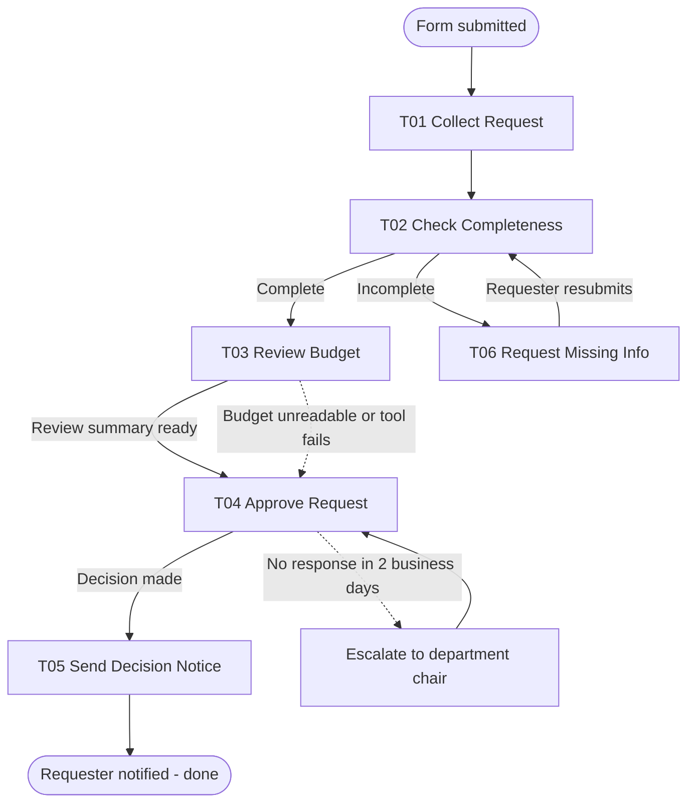

# Workflow of Tasks

**Charter:** [Team charter](../../README.md)

**Trigger:** A club officer submits the Event Request Form.

**Completion condition:** The requester receives an approval or denial notice with reasons.

## Description

The form submission is stored (T01) and checked for required fields (T02). Complete requests go to the budget review agent (T03), whose summary goes to the advisor for the decision (T04). The decision is sent to the requester (T05). If a request is incomplete, the requester is asked for the missing items (T06) and resubmits, which restarts T02. If T03 cannot read the budget or the advisor does not respond in time, the request goes to the advisor for manual handling.

## Diagram

